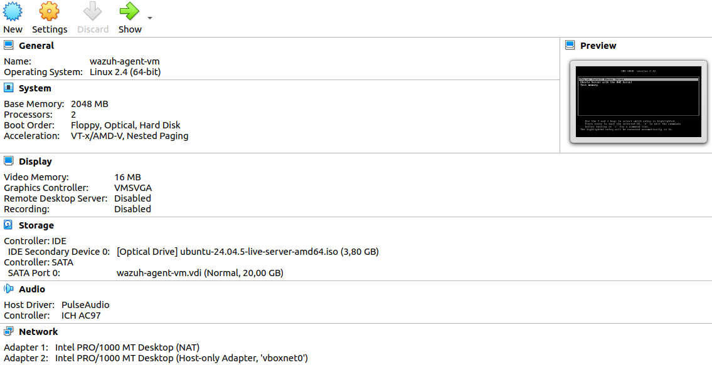

# Monitored Linux VM (VirtualBox)

A separate Linux virtual machine serves as the monitored endpoint. Events therefore reach the Wazuh manager over the network, as in a real deployment, and attack tests do not affect the Wazuh host.

## Design decisions

### Separate VM instead of a local agent

Two placements for the Wazuh agent were considered: directly on the Ubuntu host that runs the Wazuh stack, or in a separate Linux VM.

| Criterion | Agent on the Wazuh host | Agent in a separate Linux VM |
| :--- | :--- | :--- |
| Setup effort | Minutes | About one hour (VM installation) |
| Realism | Low: manager and monitored machine are the same host | High: events arrive over the network, as in a real deployment |
| Attack testing | Awkward: attacks hit the host itself | Safe: failed SSH logins, new users and Active Response take place in a disposable machine |
| Firewall validation | No: local traffic does not pass the `DOCKER-USER` rules | Yes: enrollment over port 1515 and events over port 1514 exercise the restricted ports with a legitimate agent |
| Risk | Active Response could block the host itself | A lockout only affects the VM |

The VM was chosen as the basis for the detection work. A local agent is only suitable as a quick smoke test of the pipeline.

### VirtualBox instead of KVM

The host firewall (`ufw`) uses `deny (routed)` as its default policy, and Docker modifies the forwarding rules as well. The default NAT network of KVM (`virbr0`) is routed traffic, so a KVM guest would probably have no internet access until additional rules were added, for example `sudo ufw route allow in on virbr0` and `sudo ufw route allow out on virbr0`. This is solvable but adds a further source of errors. The NAT mode of VirtualBox does not modify the iptables rules of the host, which avoids the problem.

### Network design

The VM uses two network adapters:

- **NAT:** internet access for package installation and for the agent.
- **Host-only:** a private link between the host and the VM (the host is usually `192.168.56.1`), used to reach the manager and to connect to the VM over SSH during the attack tests. The VM is not exposed to the Wi-Fi network.


## Part 1: Preparation and installation of VirtualBox


### 1. Checking the prerequisites

The CPU virtualization support, the Ubuntu version and the Secure Boot state of the host were checked:

```bash
egrep -c '(vmx|svm)' /proc/cpuinfo
lsb_release -a
mokutil --sb-state
```

**Output:**

```text
16
No LSB modules are available.
Distributor ID:	Ubuntu
Description:	Ubuntu 20.04.6 LTS
Release:	20.04
Codename:	focal
SecureBoot disabled
```

The output confirms the following:

- **Virtualization:** the first command counts the lines in `/proc/cpuinfo` that contain a hardware virtualization flag (`vmx` on Intel, `svm` on AMD). A value above 0 means that the CPU supports virtualization. The value `16` corresponds to the flag lines of 8 logical processors. A value of 0 would indicate that virtualization is disabled in the BIOS (on HP devices under **Virtualization Technology (VTx)**).
- **Operating system:** the host runs Ubuntu 20.04.6 LTS. The version determines which VirtualBox release the Ubuntu repositories provide.
- **Secure Boot:** it is disabled, so the VirtualBox kernel modules load without signing and no key enrollment (MOK) was required. With Secure Boot enabled, a one-time enrollment at the next reboot would have been necessary.


### 2. Installing VirtualBox from the Ubuntu repositories

VirtualBox was installed from the Ubuntu repositories. The package pulls in DKMS (Dynamic Kernel Module Support), which builds the required kernel modules for the running kernel. The provided version depends on the Ubuntu release (version 6.1 on Ubuntu 20.04). The installation was then verified:

```bash
sudo apt update
sudo apt install virtualbox
vboxmanage --version
lsmod | grep vbox
```

**Output:**

```text
6.1.50_Ubuntur161033
vboxnetadp             28672  0
vboxnetflt             28672  0
vboxdrv               573440  2 vboxnetadp,vboxnetflt
```

`vboxmanage --version` shows the installed version, and `lsmod` lists the loaded `vbox` kernel modules. The output confirms the following:

- **Version:** VirtualBox 6.1.50 (Ubuntu build) was installed from the Ubuntu repositories.
- **Kernel modules:** the modules were built and loaded successfully. `vboxdrv` is the core virtualization driver, `vboxnetadp` provides the host-only network adapters, and `vboxnetflt` provides the network filter used for bridged networking. No signing was required, because Secure Boot is disabled.


## Part 2: Ubuntu Server image and virtual machine


### 3. Downloading and verifying the Ubuntu Server image

The Ubuntu Server 24.04 LTS image (amd64, "live server") was downloaded from the official Ubuntu release server. The checksum file was downloaded first, because it lists the exact names of the available images. These names contain the number of the point release, which changes over time.

```bash
cd ~/Downloads
wget https://releases.ubuntu.com/24.04/SHA256SUMS
grep live-server SHA256SUMS
```

**Output:**

```text
--2026-11-16 09:27:46--  https://releases.ubuntu.com/24.04/SHA256SUMS
Resolving releases.ubuntu.com (releases.ubuntu.com)... 2620:2d:4002:1::107, 2620:2d:4000:1::1a, 2620:2d:4002:1::108, ...
Connecting to releases.ubuntu.com (releases.ubuntu.com)|2620:2d:4002:1::107|:443... connected.
HTTP request sent, awaiting response... 200 OK
Length: 893
Saving to: 'SHA256SUMS'

SHA256SUMS            100%[===================>]     893  --.-KB/s    in 0s

2026-11-16 09:27:46 (53,7 MB/s) - 'SHA256SUMS' saved [893/893]

c3514bf0056180d09376462a7a1b4f213c1d6e8ea67fae5c25099c6fd3d8274b *ubuntu-24.04.3-live-server-amd64.iso
e907d92eeec9df64163a7e454cbc8d7755e8ddc7ed42f99dbc80c40f1a138433 *ubuntu-24.04.4-live-server-amd64.iso
97f3d7ffb032c3eb3b23d2c8be9cc76e60c2c1f2c0146ba5ba9fe01cafae0fd8 *ubuntu-24.04.5-live-server-amd64.iso
```

The checksum file listed three point releases of the 24.04 LTS image (24.04.3, 24.04.4 and 24.04.5). The newest one, 24.04.5, was chosen, because it contains the most updates and therefore requires the fewest package updates after the installation.


The image was then downloaded under the name shown in the checksum file:

```bash
wget https://releases.ubuntu.com/24.04/ubuntu-24.04.5-live-server-amd64.iso
```

**Output:**

```text
--2026-11-16 09:32:42--  https://releases.ubuntu.com/24.04/ubuntu-24.04.5-live-server-amd64.iso
Resolving releases.ubuntu.com (releases.ubuntu.com)... 2620:2d:4000:1::1a, 2620:2d:4000:1::17, 2620:2d:4002:1::107, ...
Connecting to releases.ubuntu.com (releases.ubuntu.com)|2620:2d:4000:1::1a|:443... connected.
HTTP request sent, awaiting response... 200 OK
Length: 4080486400 (3,8G) [application/x-iso9660-image]
Saving to: 'ubuntu-24.04.5-live-server-amd64.iso'

ubuntu-24.04.5-live-server-amd64.iso  100%[===================>]   3,80G  13,3MB/s    in 4m 59s

2026-11-16 09:37:42 (13,0 MB/s) - 'ubuntu-24.04.5-live-server-amd64.iso' saved [4080486400/4080486400]
```

The server answered with `200 OK`, and the image of 3.8 GB (4,080,486,400 bytes) was saved completely: the number of received bytes equals the announced length. A complete transfer alone does not prove that the content is unchanged, so the checksum was verified next. With both files in the same folder, `sha256sum` compares the checksum of the image with the value in the checksum file, and `--ignore-missing` skips the entries of the checksum list that were not downloaded:

```bash
sha256sum -c SHA256SUMS --ignore-missing
```

**Output:**

```text
ubuntu-24.04.5-live-server-amd64.iso: OK
```

The result `OK` confirms that the image was transferred completely and matches the checksum published by Ubuntu. A result of `FAILED` would indicate a damaged download, and the image would have to be downloaded again.


### 4. Creating the virtual machine in VirtualBox

The virtual machine for the monitored endpoint was created in VirtualBox with a deliberately small configuration, since it only runs a minimal Ubuntu Server, the Wazuh agent and the services needed for the tests (such as an SSH server).

| Setting | Value | Reason |
| :--- | :--- | :--- |
| Name | `wazuh-agent-vm` | Identifies the role of the machine |
| Type / version | Linux / Ubuntu (64-bit) | Matches the installed image |
| Memory | 2048 MB | Sufficient for Ubuntu Server and the Wazuh agent, and leaves enough memory for the Wazuh stack on the host (16 GB in total) |
| Processors | 2 CPUs | Sufficient for the lab workload |
| Hard disk | 20 GB, VDI, dynamically allocated | VDI is the native VirtualBox format; dynamic allocation lets the file grow only as the VM uses space |
| Installation medium | `ubuntu-24.04.5-live-server-amd64.iso` | The verified image from step 3 |

The number of processors was set under **Settings > System > Processor**. The verified image was attached under **Settings > Storage**: the empty optical drive was selected, and the file `~/Downloads/ubuntu-24.04.5-live-server-amd64.iso` was chosen through the disc icon with **Choose a disk file**.

#### Network configuration

The VM was given two network adapters with different purposes:

| Adapter | Mode | Purpose |
| :--- | :--- | :--- |
| Adapter 1 | NAT | Internet access for package installation and updates; the VM is not reachable from the local network through this adapter |
| Adapter 2 | Host-only (`vboxnet0`) | Private link between the Wazuh host and the VM, used for agent communication with the manager and for SSH access from the host during the attack tests |

This separation keeps the VM off the Wi-Fi network, so other devices cannot reach it, while the host and the VM can still communicate directly. Traffic over the host-only network arrives at the host on the `vboxnet0` interface and not on the LAN interface to which the `DOCKER-USER` rules from [02 Hardening](02-hardening.md) apply.

The host-only network was created under **File > Host Network Manager > Create**. After the VM was started, the interface `vboxnet0` came up, and the address of the host on the host-only network was checked:

```bash
ip -4 addr show vboxnet0
```

**Output:**

```text
6: vboxnet0: <BROADCAST,MULTICAST,UP,LOWER_UP> mtu 1500 qdisc fq_codel state UP group default qlen 1000
    inet 192.168.56.1/24 brd 192.168.56.255 scope global vboxnet0
       valid_lft forever preferred_lft forever
```

The interface was `UP` and carried the address `192.168.56.1/24`, as configured in VirtualBox. This confirms that VirtualBox activates the host-only interface together with the running VM.

#### Screenshots of the configuration




## Part 3: Guest operating system and access
 

### 5. Installing Ubuntu Server in the VM
 
The VM was started from the attached, verified installation image, and Ubuntu Server 24.04.5 LTS was installed with the following choices:
 
| Setting | Value | Reason |
| :--- | :--- | :--- |
| Storage layout | Standard partitions on the 20 GB virtual disk, without LVM | LVM (Logical Volume Manager) adds flexible resizing and volume snapshots, which a single-purpose lab VM does not need; the virtual disk can still be enlarged in VirtualBox later |
| Hostname | `lab` | Short name of the monitored endpoint |
| User | `nescat` | Administrative user of the VM (`sudo`) |
 

### 6. Console access and working method
 
The console window of a server installation is text-only. The session type inside the VM confirms this:
 
```bash
echo $XDG_SESSION_TYPE
```
 
**Output:**
 
```text
tty
```
 
The value `tty` indicates a plain text console without a graphical session. Guest Additions features that depend on a desktop, namely the shared clipboard and the mouse pointer integration, are therefore not available, and clicking into the console window captures the mouse until it is released with the host key (Right Ctrl). A desktop environment was deliberately not installed, because it would consume additional memory and disk space and is not needed for log analysis. Instead, commands are pasted from the host into an SSH session, where the clipboard of the host terminal works normally.
 

### 7. Verifying the host-only network

The host-only network was verified on the host and inside the VM. First, the host-only interface was listed:

```bash
VBoxManage list hostonlyifs
```

**Output (excerpt):**

```text
Name:            vboxnet0
DHCP:            Disabled
IPAddress:       192.168.56.1
NetworkMask:     255.255.255.0
Status:          Up
```

The attachment of the two adapters of the VM was checked next:

```bash
VBoxManage showvminfo "wazuh-agent-vm" | grep -E "^NIC [12]:"
```

**Output (MAC addresses redacted, trailing fields omitted):**

```text
NIC 1:  MAC: <redacted>, Attachment: NAT, Cable connected: on, ...
NIC 2:  MAC: <redacted>, Attachment: Host-only Interface 'vboxnet0', Cable connected: on, ...
```

The `DHCP: Disabled` entry of the interface listing does not mean that no addresses are assigned, because VirtualBox runs its DHCP servers as separate objects. They were listed with:

```bash
VBoxManage list dhcpservers
```

**Output (excerpt):**

```text
NetworkName:    HostInterfaceNetworking-vboxnet0
Dhcpd IP:       192.168.56.100
LowerIPAddress: 192.168.56.101
UpperIPAddress: 192.168.56.254
NetworkMask:    255.255.255.0
Enabled:        Yes
```

Finally, the interfaces were checked inside the VM:

```bash
ip -br a
```

**Output (IPv6 link-local addresses shortened):**

```text
lo               UNKNOWN        127.0.0.1/8 ::1/128
enp0s3           UP             10.0.2.15/24 metric 100 fe80::...
enp0s8           UP             192.168.56.107/24 metric 100 fe80::...
```

The output confirms the following:

- **Host-only interface:** `vboxnet0` is up and carries the host address `192.168.56.1/24`.
- **Adapters of the VM:** Adapter 1 is attached to NAT and Adapter 2 to `vboxnet0`, both with the cable connected.
- **Address assignment:** a DHCP server for `vboxnet0` is enabled at `192.168.56.100` and hands out addresses from `192.168.56.101` to `192.168.56.254`.
- **Interfaces in the VM:** both interfaces are up. `enp0s3` (NAT) has the address `10.0.2.15/24`, and `enp0s8` (host-only) received `192.168.56.107/24` from the DHCP server.


### 8. SSH access through NAT port forwarding

The VM runs an OpenSSH server. Because the NAT adapter hides the VM from the host network, a port-forwarding rule was added under **Settings > Network > Adapter 1 > Advanced > Port Forwarding**:

| Name | Protocol | Host IP | Host port | Guest IP | Guest port |
| :--- | :--- | :--- | :--- | :--- | :--- |
| `ssh` | TCP | `127.0.0.1` | 2222 | (empty) | 22 |

The rule forwards port 2222 on the loopback interface of the host to port 22 of the VM. Binding the rule to `127.0.0.1` keeps the forwarded port reachable from the host only, so the VM is not exposed through the Wi-Fi address of the host. The connection was opened from a terminal on the host:

```bash
ssh -p 2222 nescat@127.0.0.1
```

**Output:**

```text
nescat@127.0.0.1's password:
Welcome to Ubuntu 24.04.5 LTS (GNU/Linux 6.8.0-149-generic x86_64)

 * Documentation:  https://help.ubuntu.com
 * Management:     https://landscape.canonical.com
 * Support:        https://ubuntu.com/pro

 System information as of Wed Nov 18 08:55:59 AM UTC 2026

  System load:  0.0                Processes:               117
  Usage of /:   27.3% of 19.51GB   Users logged in:         1
  Memory usage: 9%                 IPv4 address for enp0s3: 10.0.2.15
  Swap usage:   0%

Expanded Security Maintenance for Applications is not enabled.

0 updates can be applied immediately.

New release '26.04.1 LTS' available.
Run 'do-release-upgrade' to upgrade to it.

Last login: Wed Nov 18 08:15:11 2026 from 10.0.2.2
```

The login message confirms the following:

- **Release and kernel:** Ubuntu 24.04.5 LTS with kernel 6.8.0-149-generic.
- **Resources:** 27.3 % of the 19.51 GB root filesystem and 9 % of the memory are in use, which fits the deliberately small configuration of 2048 MB and 20 GB.
- **Updates:** no updates were pending. The offered upgrade to the next LTS release was not performed, so that the lab stays on Ubuntu 24.04 LTS.
- **Source address:** the previous login came from `10.0.2.2`, the address under which the NAT of VirtualBox presents the host to the VM. Logins through the port forward therefore appear with this source address in the logs of the VM.

#### Restricting the forwarded port to the host

The rule in the table above is the final configuration. The first version of the rule left the Host IP empty. A check of the listening sockets on the host showed which address the forwarded port was bound to:

```bash
ss -tlnp | grep 2222
```

**Output (first version of the rule, empty Host IP):**

```text
LISTEN  0        10               0.0.0.0:2222           0.0.0.0:*
```

`0.0.0.0` means that the port accepted connections on all network interfaces of the host, including the Wi-Fi interface, so other devices in the local network could have reached the SSH login of the VM. This contradicted the design goal that the VM is not exposed to the Wi-Fi network. The rule was therefore recreated with the Host IP `127.0.0.1` and checked again:

```bash
VBoxManage controlvm "wazuh-agent-vm" natpf1 delete ssh
VBoxManage controlvm "wazuh-agent-vm" natpf1 "ssh,tcp,127.0.0.1,2222,,22"
ss -tlnp | grep 2222
```

**Output:**

```text
LISTEN  0        10             127.0.0.1:2222           0.0.0.0:*
```

The forwarded port now accepts connections on the loopback interface of the host only.


### 9. SSH access over the host-only network

SSH access over the private host-only link was tested from a terminal on the host, using the address that the VM had received from the DHCP server:

```bash
ssh nescat@192.168.56.107
```

**Output:**

```text
nescat@192.168.56.107's password:
Welcome to Ubuntu 24.04.5 LTS (GNU/Linux 6.8.0-149-generic x86_64)

 * Documentation:  https://help.ubuntu.com
 * Management:     https://landscape.canonical.com
 * Support:        https://ubuntu.com/pro

 System information as of Wed Nov 18 09:42:12 AM UTC 2026

  System load:  0.0                Processes:               121
  Usage of /:   27.3% of 19.51GB   Users logged in:         1
  Memory usage: 11%                IPv4 address for enp0s3: 10.0.2.15
  Swap usage:   0%

0 updates can be applied immediately.

Last login: Wed Nov 18 08:56:00 2026 from 192.168.56.1
```

The connection succeeded on the standard SSH port 22, without any port forwarding. The `Last login` line shows the source address of the previous session: `192.168.56.1`, the address of the host on `vboxnet0`. The VM therefore sees connections over the host-only network as coming from the host-only address of the host, whereas connections through the NAT port forward appear as `10.0.2.2` (step 8).

The two access paths differ as follows:

| | NAT port forward | Host-only network |
| :--- | :--- | :--- |
| Command | `ssh -p 2222 nescat@127.0.0.1` | `ssh nescat@192.168.56.107` |
| Path | Through the NAT adapter and the forwarding rule (host port 2222 to guest port 22) | Directly over `vboxnet0` to the own address of the VM |
| Source address seen in the VM | `10.0.2.2` | `192.168.56.1` |
| Depends on | The forwarding rule in VirtualBox | The address of `enp0s8` (currently a DHCP lease) |
| Intended use | Fallback access | SSH sessions, agent communication with the manager and network scans of the VM |

The host-only path matches the network design of this lab: the VM is reachable on a private link, as a machine in a real network would be, and its own address can be used as a scan target in later chapters.


### 10. Verifying connectivity to the Wazuh manager

The Wazuh agent in the VM needs two TCP connections to the manager on the host: port 1515 for the one-time enrollment and port 1514 for the continuous event stream. Before installing the agent, the reachability of both ports was tested.

First, the Wazuh containers were started on the host. As long as they are stopped, nothing listens on ports 1514 and 1515, and every connection attempt from the VM fails.

Then the reachability of both ports was tested from the VM with netcat (`-z` checks the port without sending data, `-v` prints the result), using the host-only address of the host:

```bash
nc -zv 192.168.56.1 1515
nc -zv 192.168.56.1 1514
```

**Output:**

```text
Connection to 192.168.56.1 1515 port [tcp/*] succeeded!
Connection to 192.168.56.1 1514 port [tcp/*] succeeded!
```

Both ports of the manager are reachable from the VM, which is the precondition for installing and enrolling the Wazuh agent.

#### Firewall rules of the host

The `DOCKER-USER` chain, in which the Docker-related firewall restrictions of the host are defined, was checked on the host:

```bash
sudo iptables -L DOCKER-USER -n -v --line-numbers
```

**Output (LAN subnet replaced by a placeholder):**

```text
Chain DOCKER-USER (1 references)
num   pkts bytes target     prot opt in        out     source           destination
1        0     0 DROP       tcp  --  <wifi-interface> *       !<LAN subnet>    0.0.0.0/0     multiport dports 1514,1515
2        0     0 DROP       udp  --  <wifi-interface> *       !<LAN subnet>    0.0.0.0/0     udp dpt:514
3        0     0 RETURN     all  --  *         *       0.0.0.0/0        0.0.0.0/0
```

The `DOCKER-USER` chain does not block the VM. Its two `DROP` rules apply only to traffic that arrives on the Wi-Fi interface `<wifi-interface>` from outside the LAN subnet, and traffic from `vboxnet0` falls through to the final `RETURN` rule. No firewall change was therefore necessary.

The monitored VM is therefore complete, and the Wazuh agent is now running on it and connected to the manager (see [04 Wazuh agent](04-wazuh-agent.md)).
